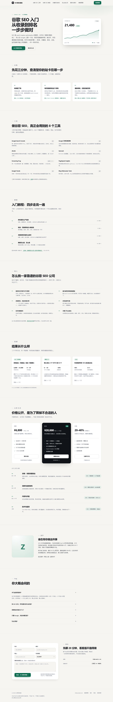

# 单页 SEO 顾问站

一个纯静态的获客落地页 + 一个只收询盘的表单接口。没有构建步骤，没有数据库，没有 npm 依赖。



```
site/        静态页面，Vercel 直接托管
  index.html      首页（全部文案都在这里）
  thanks.html     提交后的感谢页（noindex）
  404.html        找不到页面
  articles/       长文页
    how-search-works.html   搜索原理科普（自序体）
  assets/         styles.css + app.js
  og.png          分享图，由 tools/make-og.py 生成
api/
  lead.js         Vercel Serverless Function：POST /api/lead
deploy/       VPS 部署脚本（Caddyfile / systemd / 装机），`vps/` 里是 VPS 版的表单服务
tools/        preview 预览、check 自检、setup 换域名、make-og 出图
vercel.json   路由（cleanUrls）与响应头
package.json  给 api/ 启用 ESM，外加一条空构建脚本
```

## 本地预览

```bash
node tools/preview.mjs          # 页面 → http://127.0.0.1:8080
```

只想看页面，到这一步就够了。

要连表单一起测，再开一个终端：

```bash
node deploy/vps/server.mjs      # 表单接口 → :3001
```

`preview.mjs` 会把 `/api/*` 转发到 :3001，所以在 :8080 上提交表单也能走完整流程，提交完跳到 `/thanks`。

> 线上用的是 `api/lead.js`（Vercel 函数），不是 `deploy/vps/server.mjs`。两者接口一致，本地哪个都能用。

改完东西跑一下自检：

```bash
node tools/check.mjs
```

它检查锚点、样式类、JSON-LD、meta、站内链接和 CSS 括号。

## 部署到 Vercel

**1. 换成你自己的信息**

```bash
node tools/setup.mjs --domain seo.yourdomain.com --email you@yourdomain.com
python tools/make-og.py       # 重新生成分享图
```

它会替换 canonical、OG、JSON-LD、robots、sitemap 里的占位信息。然后再手动改首页里标了「示例」的三组案例数字。

**2. 推上 GitHub**

```bash
git init && git add . && git commit -m "init"
git remote add origin git@github.com:you/seoagent.git
git push -u origin main
```

**3. 在 Vercel 导入项目**

Dashboard → **Add New…** → **Project** → 选你的仓库 → 进入 **Configure Project**。

只填 **Project Name**，Build & Output Settings 全部留默认，直接点 **Deploy**。

原因：仓库里的 `vercel.json` 已经写死了这几个值，会覆盖面板上的同名设置。

| 设置项 | 值 | 来源 |
| --- | --- | --- |
| Framework Preset | `Other` | 不选框架时 Vercel 自动就是它 |
| Build Command | `npm run build` | `package.json` 里那条 echo，跑完什么也不产出 |
| Output Directory | `site` | `vercel.json` 的 `outputDirectory` |

> `outputDirectory` 的语义是「只把这一目录的内容当静态文件发出去」，默认是 `public` 或仓库根目录，见 [vercel.json 文档](https://vercel.com/docs/project-configuration/vercel-json#outputdirectory)。`api/` 是另一个机制：Vercel 会「为根目录 `api/` 下每个文件建一个函数」（[Node.js Runtime 文档](https://vercel.com/docs/functions/runtimes/node-js)），和输出目录互不影响。

**4. 配环境变量**

**Settings → Environment Variables → Add New**，至少配「邮件」这一组（见下一节）。变量按环境生效，Production 一定要勾上。配完去 Deployments 里点最新一次的 **Redeploy**，否则旧构建读不到。

**5. 绑域名**

**Settings → Domains** → Add，输入域名，按提示在域名商改 DNS。Vercel 自动签证书，不用管 80/443。

最后打开首页提交一次表单，确认能跳到 `/thanks`、你能收到邮件。

### 环境变量

| 变量 | 必填 | 说明 |
| --- | --- | --- |
| `RESEND_API_KEY` | 建议 | [resend.com](https://resend.com) 的 API Key，验证发信域名后可用 |
| `MAIL_TO` | 建议 | 收线索的邮箱，多个用逗号分隔 |
| `MAIL_FROM` | 建议 | 如 `站点询盘 <lead@yourdomain.com>`，域名要和 Resend 里验证的一致 |
| `NOTIFY_WEBHOOK` | 可选 | 群机器人地址 |
| `NOTIFY_WEBHOOK_KIND` | 可选 | `wecom` / `feishu` / `telegram` / `generic` |
| `TELEGRAM_CHAT_ID` | 可选 | 只有选 telegram 才需要 |
| `UPSTASH_REDIS_REST_URL` | 可选 | 把线索额外存一份 |
| `UPSTASH_REDIS_REST_TOKEN` | 可选 | 同上 |
| `RATE_LIMIT_PER_HOUR` | 可选 | 默认 6 |

## 线索存在哪

Vercel 上是 serverless，**没有本地磁盘可以写**，所以和 VPS 版不一样：

- **邮件**（Resend）—— 主渠道，收到就能直接回复客户
- **群机器人** —— 即时提醒，手机上不会漏
- **Upstash Redis** —— 可选，存一份原始记录。在 Vercel 的 Marketplace 里加 Upstash，环境变量会自动注入，`api/lead.js` 会自己识别并 `LPUSH` 到 `seoagent:leads`

**至少配两个。** 只配一个的话，那个渠道挂了这次询盘就没了——这是 serverless 相比「本地落盘」唯一明显的退步。

## 备选：部署到 Vultr VPS

如果不想用 Vercel，仓库里这套还能直接上 VPS（$3.50/月那一档，带 IPv4）。

```bash
scp deploy/bootstrap.sh root@<IP>:/root/
ssh root@<IP> "bash /root/bootstrap.sh"

node tools/setup.mjs --domain seo.yourdomain.com --email you@yourdomain.com
./deploy/deploy.ps1 -Server <IP> -Full      # Windows
./deploy/deploy.sh <IP> --full              # macOS / Linux
```

DNS 指向机器 IP，Caddy 会自动签证书。表单走 `deploy/vps/server.mjs`，线索落在 `/srv/seoagent/server/data/leads.ndjson`：

```bash
ssh root@<IP> "cd /srv/seoagent/server && node scripts/leads.mjs"
```

VPS 版要把 `deploy/vps/.env.example` 复制成 `.env` 再填，环境变量名和 Vercel 那边完全一样。

两种方式选一个就行，接口路径都是 `/api/lead`，前端不用改。

## 改文案

所有文字都在 `site/index.html`，按 `<!-- ==== 分节 ==== -->` 的注释找：

| 想改什么 | 找哪里 |
| --- | --- |
| 首屏标题、副标题 | 搜 `hero` 区块 |
| 三步自检 | 搜 `id="check"` |
| 工具清单 | 搜 `id="tools"` |
| 入门教程 | 搜 `id="guide"` |
| 怎么挑公司 | 搜 `id="choose"` |
| 案例数字 | 搜 `id="cases"`，**必须换成你自己的真实数据** |
| 报价与合作流程 | 搜 `id="pricing"` |
| 问答 | 搜 `id="faq"`，**改完同步页面顶部 JSON-LD 里的 FAQ** |
| 邮箱 | 搜 `hi@example.com` |
| 颜色 | `site/assets/styles.css` 最上面的 `:root` 变量 |
| 分享图 | 改 `tools/make-og.py` 顶部常量后重跑 |

## 加一篇新文章

长文页在 `site/articles/`，直接复制 `how-search-works.html` 改：

1. 改 `title` / `description` / `canonical` / `og:*`，canonical 用不带 `.html` 的地址（Vercel 的 `cleanUrls` 会处理跳转）
2. 改顶部 JSON-LD 的 `headline`、`datePublished`、`mainEntityOfPage`
3. 正文放在 `<article class="prose">` 里，`<h2 id="...">` 的 id 要和目录的 `href="#..."` 对上
4. 在 `site/sitemap.xml` 加一条，在首页 `id="guide"` 的教程列表里加一条
5. 跑 `node tools/check.mjs`

## 常见问题

**构建失败：`No entrypoint found in ".../server"`**：Vercel 会把仓库里任何带 `package.json` 的子目录当成第二个 Node 应用去构建，然后又在构建前按 `.vercelignore` 把里面的文件删了，于是找不到入口。所以 VPS 版的服务不能放在带 `package.json` 的 `server/` 里——现在它在 `deploy/vps/`，整个 `deploy/` 都不上传。**以后加目录，别在里面放 `package.json`。**

**Vercel 上提交表单 404**：确认 `api/lead.js` 在仓库根目录，且 Output Directory 是 `site`。`api/` 是 Vercel 的特殊目录，不受 `outputDirectory` 影响。

**Vercel 上提交成功但没收到邮件**：看项目 → Deployments → Functions → Logs，搜 `[notify]`。多数是 Resend 的发信域名没验证，或者 `MAIL_FROM` 的域名和验证的不一致。

**表单报 400**：邮箱或网站格式没过校验，这是故意的。

**提交提示太频繁**：默认每实例每小时 6 次，改 `RATE_LIMIT_PER_HOUR`。注意 serverless 的计数是按实例的，不是全局限流。

**VPS 上打开是 502**：`systemctl status seoagent`，再看 `journalctl -u seoagent -n 50`。

**VPS 上证书申请失败**：80/443 没放行，或 DNS 还没生效，`journalctl -u caddy -n 50`。

## 为什么没有构建步骤

这个站是静态 HTML + 手写 CSS，改完刷新就能看，部署就是拷文件。少一层工具链，就少一类「本地能跑线上不一样」的问题。以后要加博客，再上 Astro 或 Hugo，现有 HTML 可以直接搬过去。
